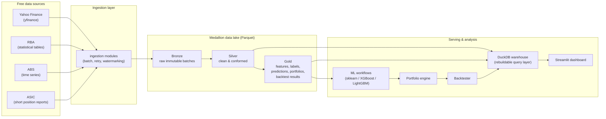

# Architecture

**Version:** 0.1 (Phase 1 — foundation)
**Scope:** system architecture, storage design, data flow, reproducibility model.

> This platform is a research tool. It is **not** financial advice and **never**
> executes live trades.

## 1. System overview



## 2. Medallion architecture

| Layer | Purpose | Immutability | Format |
|---|---|---|---|
| **Bronze** | Data as received from the source, minimal transformation. Audit columns (`source`, `retrieved_at`, `ingestion_run_id`, `batch_id`). | **Append-only.** Re-ingestion writes a NEW batch file; originals are never overwritten or deleted. | Parquet, partitioned `bronze/<domain>/<ticker>/<batch>.parquet` |
| **Silver** | Cleaned, typed, deduplicated, standardised. Ticker conventions, date/timestamp conventions, quality flags. | Regenerable from Bronze. Overwrites require `overwrite=True` (explicit). | Parquet, single file per dataset (`silver/<name>.parquet`) |
| **Gold** | Analytical/ML datasets: features, target labels, predictions, portfolio positions, backtest results. | Regenerable from Bronze+Silver. Deterministic transforms only. | Parquet |

Key rules:

1. **Parquet is the system of record.** The DuckDB file (`data/warehouse.duckdb`)
   is a query layer. Deleting it loses nothing: it is rebuilt from Parquet
   (schemas, metadata tables and views are recreated on `initialise`).
2. **Every Parquet dataset written via `asx_quant.storage.parquet.ParquetWriter`**
   is stamped with `ingestion_run_id` and `retrieved_at` (UTC ISO-8601), and is
   written with deterministic compression (`zstd/3`) so identical inputs
   produce identical schema and statistics.
3. **Silent overwrites are refused.** `ParquetWriter.write(..., overwrite=False)`
   raises `StorageError` — bronze batches must use a new batch id, and
   silver/gold regeneration must be explicit.
4. **Silent value replacement is forbidden.** Missing data stays missing
   (documented null policies) until an explicit, logged imputation step.

## 3. DuckDB warehouse design

- **Schemas:** `bronze`, `silver`, `gold` mirror the Parquet layers;
  `meta` holds operational metadata.
- **Views, not copies.** Each registered dataset becomes a
  `CREATE OR REPLACE VIEW ... AS SELECT * FROM read_parquet('<path>')` so the
  warehouse always reads current Parquet state with zero duplication.
  (Windows paths are normalised to forward slashes — DuckDB string literals
  treat backslashes as escape characters.)
- **Metadata tables** (`meta.warehouse_meta`, `meta.dataset_registry`) record
  dataset paths, row counts and last-refresh timestamps; they power the
  dashboard's "Data quality & pipeline" page (Phase 9).

## 4. Reproducibility and run model

Every pipeline execution gets a **run id** (`<UTC timestamp>-<8 hex>`),
configuration version and (for model stages) a model version. Stage records —
`run_id, stage, started/finished, status, record_count, error, details` — are
appended to `data/reports/runs/run_log.jsonl`. The latest run is also written
to `latest_run.json` for quick diagnostics.

Operating modes (Phase 9 implements both; the registry is live from Phase 1):

- **Historical build:** full rebuild from ingestion to backtest, restartable at
  stage boundaries (completed stages are skipped by watermark checks).
- **Incremental:** fetch data after the latest watermark, reconcile the most
  recent sessions (free providers revise recent bars), recompute affected
  rolling features, update predictions, emit a new portfolio recommendation.

## 5. Determinism and integrity controls

- Configuration-driven behaviour only — thresholds, paths and parameters live
  in `config/*.yaml`, never in code (verified by tests).
- Cross-file consistency is validated (e.g. the portfolio signal must be a
  declared target; the backtest test window must be in the past).
- Rolling features will be computed per-security with a single canonical
  implementation in `asx_quant.features` (no duplicated calculation paths).
- Leakage controls (enforced by tests from Phase 4): features may only use data
  at or before the prediction timestamp; macro/ASIC features join on
  **publication date**, never observation period.

## 6. Directory layout

```
asx-quant-ml/
├── config/          # settings, universe, portfolio, features, backtest
├── data/
│   ├── bronze/{prices,security_master,rba,abs,asic,announcements}/
│   ├── silver/
│   ├── gold/
│   ├── models/
│   ├── reports/     # data-quality reports, run logs
│   └── warehouse.duckdb
├── docs/            # this file, data model, dictionary, methodologies
├── notebooks/       # EDA + experiments (Phase 5+)
├── src/asx_quant/   # config, ingestion, storage, transformations, quality,
│                    # features, labels, modelling, portfolio, backtesting,
│                    # reporting, pipeline, observability
├── dashboard/       # Streamlit (Phase 9+)
├── tests/           # pytest suite (32 tests at Phase 1)
└── scripts/         # convenience entrypoints
```

## 7. Technology choices

| Concern | Choice | Rationale |
|---|---|---|
| Language | Python 3.13 (pinned `>=3.13,<3.14`) | Full wheel availability for pandas/XGBoost/LightGBM |
| Env manager | uv (project venv, `uv.lock`) | Fast, reproducible installs; never touches global packages |
| Storage | Parquet (zstd) + DuckDB | Free, local, columnar, SQL over the lake |
| Market data | yfinance | Free OHLCV + dividends + splits |
| Macro data | RBA / ABS published files | Free official sources (Phase 3) |
| ML | scikit-learn, XGBoost, LightGBM | Baselines → tree ensembles per roadmap |
| Dashboard | Streamlit | Multi-page research UI (Phase 9) |
| Testing | pytest, ruff | 32 tests, lint-clean at Phase 1 |
