# Logical Data Model

**Version:** 0.1 (Phase 1)
The physical design is Parquet files + DuckDB views; this document defines the
logical entities, grains, keys and relationships. The data dictionary lives in
`docs/data_dictionary.md`.

## 1. Entity-relationship diagram

```mermaid
erDiagram
    DIM_SECURITY ||--o{ FACT_EQUITY_PRICE : "has"
    DIM_SECURITY ||--o{ FACT_SHORT_POSITION : "has"
    DIM_SECURITY ||--o{ FACT_ANNOUNCEMENT : "has"
    DIM_SECURITY ||--o{ FACT_FEATURES : "has"
    DIM_SECURITY ||--o{ FACT_PREDICTIONS : "has"
    DIM_SECURITY ||--o{ FACT_PORTFOLIO_POSITION : "selected as"
    DIM_DATE ||--o{ FACT_EQUITY_PRICE : "dates"
    DIM_SECURITY }o--|| DIM_SECTOR : "classified into"
    MACRO_SERIES ||--o{ FACT_MACROECONOMIC : "observed as"
    DIM_PORTFOLIO ||--o{ FACT_PORTFOLIO_POSITION : "holds"
    DIM_PORTFOLIO ||--o{ FACT_BACKTEST_DAILY : "valued as"

    DIM_SECURITY {
        string security_key PK "surrogate (hash of ticker+as_of)"
        string ticker "ASX code with .AX suffix"
        string company_name
        string exchange "always ASX"
        string sector_key FK
        string industry
        date listing_date "nullable"
        date delisting_date "nullable"
        string currency "AUD"
        string instrument_type "ordinary_share"
        bool active_flag
        string source_identifier "yfinance ticker"
        string inclusion_methodology "current_constituent_proxy | manual_list"
        string data_quality_status
    }

    DIM_SECTOR {
        string sector_key PK
        string sector_name
        string gics_sector_group "if obtainable free"
    }

    DIM_DATE {
        int date_key PK "YYYYMMDD"
        date calendar_date
        int calendar_year
        int calendar_month
        int calendar_quarter
        int day_of_week
        bool is_asx_trading_day
        int trading_day_sequence "ASX session index"
        int financial_year "AU: starts 1 July"
    }

    DIM_PORTFOLIO {
        string portfolio_id PK "e.g. ml_long_only_v1"
        string model_version
        string portfolio_config_version
        string direction "long_only"
    }

    FACT_EQUITY_PRICE {
        string security_key FK
        int date_key FK
        decimal open_price
        decimal high_price
        decimal low_price
        decimal close_price "raw"
        decimal adjusted_close "split+div adjusted"
        bigint volume
        decimal dividend_amount
        decimal split_factor
        decimal daily_return
        string source_identifier
        string ingestion_run_id FK
    }

    MACRO_SERIES {
        string macro_series_key PK "e.g. rba_cash_rate"
        string source "rba | abs"
        string units
        string frequency "daily | monthly | quarterly"
        string revision_status "final | potentially_revised"
    }

    FACT_MACROECONOMIC {
        string macro_series_key FK
        date observation_date
        date publication_date "point-in-time join key"
        decimal value
        string unit
        string frequency
        string source
        timestamp retrieved_at
        string vintage_or_revision_flag
    }

    FACT_SHORT_POSITION {
        string security_key FK
        date reporting_date
        date publication_date
        decimal reported_short_position "units"
        decimal percentage_of_issued_capital
        string source "ASIC"
    }

    FACT_ANNOUNCEMENT {
        string announcement_key PK
        string security_key FK
        timestamp publication_timestamp
        string announcement_category
        string headline
        string source_url
        string text_reference
        float sentiment_score "nullable; optional extension"
        string source_permission_status
    }

    FACT_FEATURES {
        string security_key FK
        date prediction_date FK
        string feature_set_version FK
        float momentum_features "flat columns, not opaque blobs"
        float volatility_features
        float volume_features
        float technical_features
        float market_features
        float macro_features
        float short_interest_features
        float announcement_features
    }

    FACT_PREDICTIONS {
        string security_key FK
        date prediction_date FK
        string model_version FK
        float predicted_return_3d
        float predicted_return_10d
        float predicted_probability_positive
        int predicted_rank
        timestamp prediction_timestamp
    }

    FACT_PORTFOLIO_POSITION {
        date rebalance_date FK
        string security_key FK
        string model_version FK
        int predicted_rank
        decimal target_weight
        decimal actual_weight
        decimal execution_price
        bigint shares_or_units
        decimal transaction_cost
        string portfolio_id FK
        string rejection_reason "nullable"
    }

    FACT_BACKTEST_DAILY {
        string portfolio_id FK
        date date FK
        decimal portfolio_value
        decimal daily_return
        decimal cumulative_return
        decimal benchmark_return
        decimal cash_weight
        decimal drawdown
        decimal transaction_cost
    }
```

## 2. Grain definitions (explicit)

| Entity | Grain | Primary key / uniqueness |
|---|---|---|
| `DIM_SECURITY` | One tradable security | `security_key` (surrogate); natural key `ticker` |
| `DIM_DATE` | One calendar date | `date_key` = `YYYYMMDD` int |
| `FACT_EQUITY_PRICE` | **One security × one ASX trading session** | `(security_key, date_key)` unique |
| `FACT_MACROECONOMIC` | One series × one observation × one publication | `(macro_series_key, observation_date, publication_date)` |
| `FACT_SHORT_POSITION` | One security × one ASIC reporting period | `(security_key, reporting_date)` |
| `FACT_ANNOUNCEMENT` | One announcement | `announcement_key` |
| `FACT_FEATURES` | One security × one prediction date × feature-set version | `(security_key, prediction_date, feature_set_version)` |
| `FACT_PREDICTIONS` | One security × one prediction date × model version | `(security_key, prediction_date, model_version)` |
| `FACT_PORTFOLIO_POSITION` | One security × one rebalance date × portfolio | `(portfolio_id, rebalance_date, security_key)` |
| `FACT_BACKTEST_DAILY` | One portfolio × one trading session | `(portfolio_id, date)` |

## 3. Key design decisions

- **Surrogate `security_key`** — stable across ticker changes (ASX codes are
  reused); maintained via the security master's source mapping.
- **`DIM_DATE.trading_day_sequence`** — a dense ASX-session index. Feature
  windows and target horizons use **session offsets, never calendar days**.
- **`publication_date` columns on macro and short-position facts** are the
  *only* join keys permitted for point-in-time feature assembly.
- **No opaque feature blobs.** `FACT_FEATURES` stores one column per feature
  (the ERD shows families for readability); definitions live in
  `asx_quant.features` and `docs/feature_catalogue.md`.
- **Slowly changing attributes.** Sector membership is held in `DIM_SECTOR`
  with history preserved where free sources allow; where not available,
  `inclusion_methodology` on `DIM_SECURITY` records the proxy used and the
  limitation is disclosed (survivorship bias).

## 4. Source-to-target mapping (Phase 1 status)

| Source field | Target entity.field | Status |
|---|---|---|
| yfinance `Open/High/Low/Close` | `FACT_EQUITY_PRICE.open_price … close_price` | Phase 2 |
| yfinance `Adj Close` | `FACT_EQUITY_PRICE.adjusted_close` | Phase 2 |
| yfinance `Volume` | `FACT_EQUITY_PRICE.volume` | Phase 2 |
| yfinance `Dividends` | `FACT_EQUITY_PRICE.dividend_amount` | Phase 2 |
| yfinance `Stock Splits` | `FACT_EQUITY_PRICE.split_factor` | Phase 2 |
| RBA statistical table series | `FACT_MACROECONOMIC` (rba rows) | Phase 3 |
| ABS time series | `FACT_MACROECONOMIC` (abs rows) | Phase 3 |
| ASIC short position reports | `FACT_SHORT_POSITION` | Phase 3 |
| Derived (vectorised calcs) | `FACT_FEATURES`, target labels | Phase 4 |
| Model output | `FACT_PREDICTIONS` | Phase 6 |
| Portfolio engine | `FACT_PORTFOLIO_POSITION` | Phase 7 |
| Backtester | `FACT_BACKTEST_DAILY` | Phase 8 |
